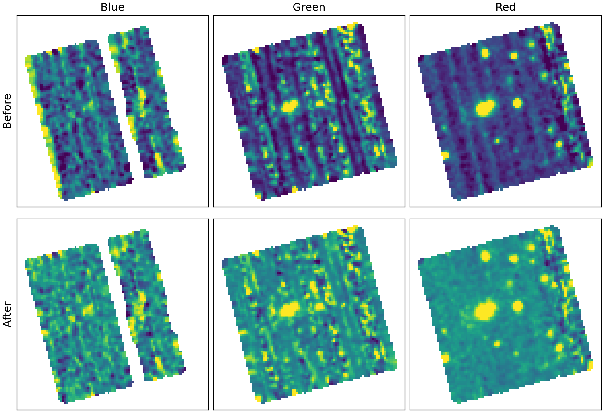

# llamas-tools

*LLAMAS TOOLS v0.1*

Here I develop a tool to remove the differential illumination residual in the datacube products reduced by `llamas-pyjamas` pipeline (v1.0; [llamas-pyjamas](https://mit-kavli-institute.github.io/llamas-pyjamas) by Hughes, Simcoe, Furesz and the LLAMAS collaboration).

## Dependencies

The code needs the `llamas-pyjamas` pipeline (v1.0) installed, since the cubes are built from the RSS files with its own functions (`build_super_rss` and `combine_cube`). Run the code in the same Python environment that you use for `llamas-pyjamas`, which already provides most of the packages below.

- [`llamas-pyjamas`](https://mit-kavli-institute.github.io/llamas-pyjamas) (v1.0)
- `numpy`
- `scipy` (the median filter, `scipy.ndimage.median_filter`)
- `astropy`
- `matplotlib`

Tested with Python 3.12, numpy 2.2, scipy 1.18, astropy 8.0 and matplotlib 3.11.

## Illumination Correction

<p align="center">
  <a href="figures/illumination_correct_example.pdf"></a>
  <br>
  <sub>A sample LLAMAS cube whitelight image (median) before and after using the illumination correction code.</sub>
</p>

The code `illumination_correct/` takes input reduced LLAMAS data cubes and uses a median filter to correct for the correlated slice-looking illumination differences of the background.

To run the illumination correction code, do this:

1. Enter the file names of the `llamas-pyjamas`-reduced data cubes that you want to correct into the `illumination_correct/input_files.txt` file. An example file is already included. Note that this code uses the **RSS** files as inputs. The cube creation is done internally using `llamas-pyjamas`'s own functions (see `treat_cube.py` for details). If you have already processed cubes that are in data cube format instead of RSS, then use the `--skip_cube_creation` flag in the command below.

2. Run the command in the terminal:

```bash
python illumination_correct.py input_files.txt
```

This first opens a GUI to define the shape of the median filter footprint. It shows the white light image of the first cube in the list, for a wavelength range that you choose, with the footprint box on top. Set the box shape (x, y) and rotate it until it is aligned with the slice-looking pattern, or click Solve Rotation to fit the angle. Click Accept to save the shape and angle to `footprint.json` (next to the input list). The window closes and the illumination correction continues with it.

If you already have a footprint file, or want to define it separately, run `python rotation_gui.py input_files.txt` first, and then give the file to the correction with the `--params` flag. The GUI is then skipped:

```bash
python illumination_correct.py input_files.txt --params footprint.json
```

The `illumination_correct.py` code will produce a set of median filtered cubes (intermediate products) and illumination corrected cubes (your desired products). Use the `--output_dir` flag to define an output directory for your median filtered and illumination corrected cubes to go.

## Cite and Credits

Written by Erik Solhaug with input by Mike Gladders.

If you use this tool for your publications, please cite the github repository (a zenodo link will be established soon).